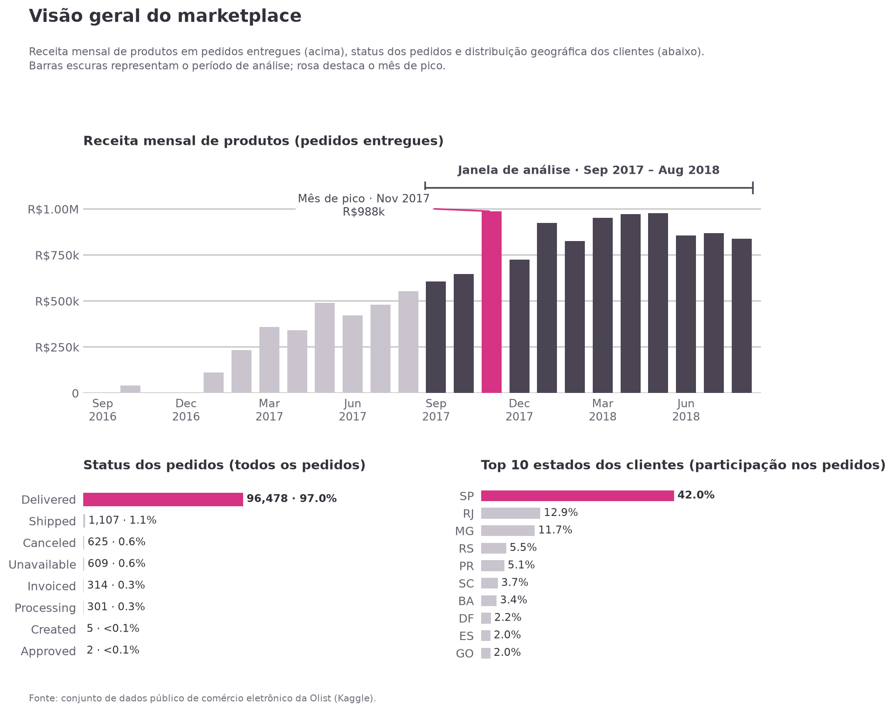
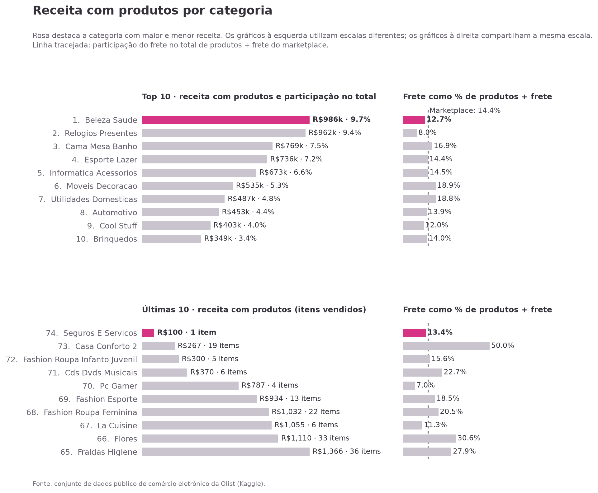
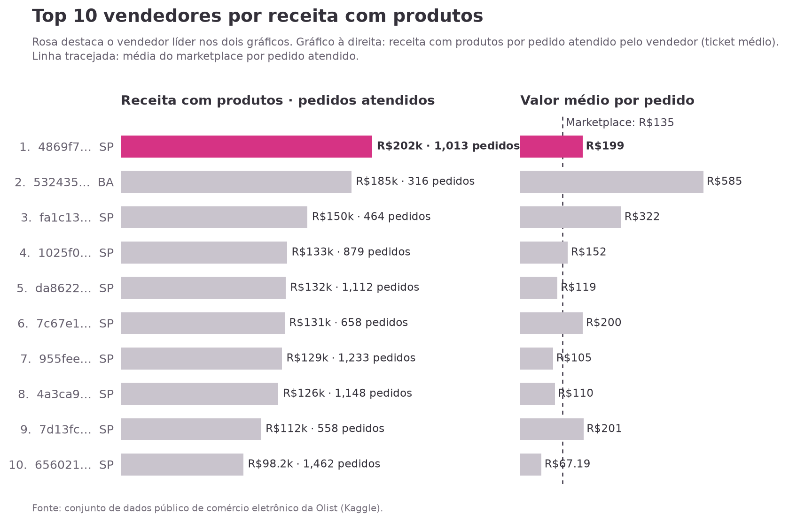
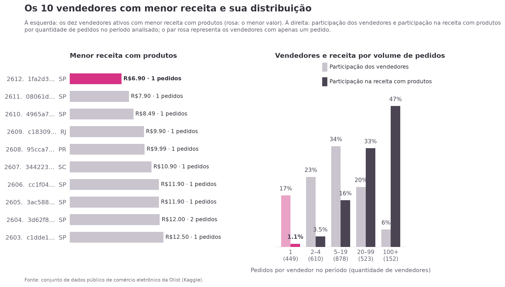

# Análise do marketplace Olist: receita por categoria e vendedor

Análise descritiva de um marketplace brasileiro a partir do conjunto de dados público da Olist. O projeto identifica quais categorias de produtos e quais vendedores geraram a **maior e a menor receita com produtos** nos 12 meses mais recentes disponíveis e mede **quanto essas respostas mudam** conforme as decisões metodológicas (definição de receita, escopo dos pedidos e janela de tempo).

> [!NOTE]
> Os resultados são **descritivos, não causais**. "Receita" aqui é o valor dos produtos vendidos pelos lojistas no marketplace, **não** a receita da Olist (os dados não informam comissões ou taxas).

## Sumário

1. [Apresentação do projeto](#1-apresentação-do-projeto)
2. [Fonte dos dados](#2-fonte-dos-dados)
3. [Metodologia](#3-metodologia)
4. [Principais resultados e descobertas](#4-principais-resultados-e-descobertas)
5. [Validação e robustez](#5-validação-e-robustez)
6. [Visualizações](#6-visualizações)
7. [Estrutura do repositório](#7-estrutura-do-repositório)
8. [Como executar o projeto](#8-como-executar-o-projeto)
9. [Próximos passos](#9-próximos-passos)

---

## 1. Apresentação do projeto

### Objetivo e problema de negócio

A pergunta central do projeto é: *quais categorias de produtos e quais vendedores geraram a maior e a menor receita com produtos nos 12 meses mais recentes do conjunto de dados, e quanto essa resposta depende das definições adotadas?*

Ela se desdobra em três perguntas de negócio:

| Nº | Pergunta |
|---|---|
| Q1 | Quais categorias de produtos têm a **maior e a menor receita**? |
| Q2 | Quais são os **10 vendedores com maior receita**? |
| Q3 | Quais são os **10 vendedores com menor receita** e o que isso realmente significa? |

Além de respondê-las, o projeto torna explícitas as definições usadas (o que conta como receita, quais pedidos entram e quais 12 meses são considerados) e testa a sensibilidade dos rankings a cada uma delas.

### Contexto

A Olist conecta pequenos lojistas a grandes marketplaces no Brasil: quando alguém compra um produto, o vendedor é notificado e fica responsável pelo pedido. A empresa publicou no Kaggle um recorte com cerca de 100 mil pedidos feitos entre 2016 e 2018, distribuídos em tabelas relacionadas (pedidos, itens, pagamentos, avaliações, clientes, vendedores e produtos).

### Tecnologias

- **Python** 3.12.3
- **pandas** 3.0.5 e **NumPy** 2.5.1 para tratamento e agregação dos dados
- **Matplotlib** 3.11.0 para os gráficos
- **Jupyter Notebook** (o notebook usa recursos do IPython)

Essas são as versões registradas na última execução do notebook; o projeto não declara versões mínimas.

---

## 2. Fonte dos dados

**Conjunto de dados:** [Brazilian E-Commerce Public Dataset by Olist](https://www.kaggle.com/datasets/olistbr/brazilian-ecommerce), publicado pela Olist no Kaggle.

> [!IMPORTANT]
> Os arquivos brutos **não estão incluídos** neste repositório. Consulte a licença na página do Kaggle antes de reutilizar ou redistribuir os dados. As instruções para obtê-los estão em [Como executar o projeto](#8-como-executar-o-projeto).

Composição dos dados e uso em cada etapa da análise (contagens de linhas conforme o inventário do notebook):

| Tabela (arquivo CSV) | Linhas | Cada linha representa | Uso na análise |
|---|---:|---|---|
| `olist_orders_dataset.csv` | 99.441 | um pedido | status, datas e definição da janela |
| `olist_customers_dataset.csv` | 99.441 | um cliente por pedido (`customer_id`) | distribuição geográfica da demanda |
| `olist_order_items_dataset.csv` | 112.650 | um item dentro de um pedido | base do cálculo de receita (`price`, `freight_value`) |
| `olist_order_payments_dataset.csv` | 103.886 | um pagamento de um pedido | apenas para **validar** os totais |
| `olist_order_reviews_dataset.csv` | 99.224 | uma avaliação | perfilada; não entra no cálculo de receita |
| `olist_products_dataset.csv` | 32.951 | um produto | categoria do produto |
| `olist_sellers_dataset.csv` | 3.095 | um vendedor | estado do vendedor |
| `product_category_name_translation.csv` | — | nome de categoria (PT → EN) | carregada; os rótulos usam os nomes originais em português |
| `olist_geolocation_dataset.csv` | 1.000.163 | uma amostra de coordenada por prefixo de CEP | apenas perfilada |

As descrições detalhadas das colunas estão em [`colunas.md`](colunas.md). Os valores monetários estão em reais (R$) e são nominais.

---

## 3. Metodologia

Todo o fluxo está no notebook [`analise_ecommerce_olist_ptbr.ipynb`](analise_ecommerce_olist_ptbr.ipynb). As seções entre parênteses indicam onde cada etapa está documentada.

**1. Carregamento e exploração (seção 2).** As nove tabelas são carregadas por uma função que interrompe a execução se algum arquivo obrigatório estiver ausente. Para cada tabela foram verificados: o que uma linha representa, se a chave documentada é realmente única, valores ausentes e linhas duplicadas.

**2. Limpeza e tratamento (seção 3.2).** As decisões foram registradas em vez de aplicadas silenciosamente:

| Problema encontrado | Decisão | Justificativa |
|---|---|---|
| Datas armazenadas como texto | Convertidas para `datetime` com formato explícito | Permite definir períodos; dados malformados geram erro em vez de virar nulos |
| 610 produtos sem categoria (todos aparecem em itens vendidos) | Mantidos com o rótulo `Sem categoria` | Removê-los apagaria vendas reais dos totais por categoria |
| Peso, dimensões e tamanhos de texto ausentes em produtos | Mantidos ausentes, sem imputação | Não são usados na análise; preencher com medianas inventaria valores |
| `review_id` repetido entre pedidos | Não removido | Avaliações não entram na receita; registrado como limitação |
| Linhas duplicadas em `geolocation` | Não alteradas | Tabela não é usada além do perfil |
| Pedidos não entregues | Excluídos da receita | A métrica considera apenas vendas concluídas |

**3. Integração entre tabelas (seção 3.4).** Os itens de pedido são unidos aos pedidos entregues (*inner join*), depois aos produtos e aos vendedores (*left join*), sempre com `validate="many_to_one"` para impedir relações muitos-para-muitos inesperadas. Duas asserções confirmam que o número de linhas de itens foi preservado (110.197 antes e depois) e que nenhuma chave ficou sem correspondência.

**4. Janela temporal (seção 3.3).** O escopo são os **12 meses-calendário completos que terminam no mês da compra entregue mais recente**: **set/2017 a ago/2018**. A data da **compra** (e não a da entrega) define quando a venda ocorreu, e meses completos evitam distorções de meses parciais. Por que não usar a data de entrega mais recente como referência? Porque ela é um caso isolado: 17/10/2018, de um pedido comprado em 02/06/2018 com entrega estimada para 13/07/2018. Essa referência deslocaria o início da janela em 46 dias.

| Escopo | Pedidos | Itens | Σ `price` |
|---|---:|---:|---:|
| Todos os pedidos do conjunto | 99.441 | 112.650 | R$ 13,59 mi |
| Entregues, com data de entrega registrada | 96.470 | 110.189 | R$ 13,22 mi |
| … e comprados na janela (set/2017 – ago/2018) | 74.206 | 84.930 | R$ 10,19 mi |

**5. Construção das métricas (seções 3.4 e 3.5).**

| Métrica | Definição |
|---|---|
| **Receita com produtos** | Soma de `price` nos pedidos entregues da janela, **sem frete**. É a métrica principal |
| **Frete** | Soma de `freight_value` dos mesmos itens. Mantido separado e analisado como dimensão adicional |
| **Produtos + frete** | Receita com produtos + frete. Usado só quando indicado |
| **Valor do pagamento** | `payment_value`. Usado apenas para validar totais, nunca como receita |
| **Valor médio por pedido (ticket)** | Receita com produtos do vendedor ÷ pedidos atendidos por ele |
| **Vendedor ativo** | Vendedor com pelo menos um pedido entregue na janela |

**6. Análise de categorias (seção 5.1).** Ranking por receita com produtos, participação no total, participação do frete em produtos + frete e comparação do ranking com e sem frete.

**7. Análise de vendedores (seções 5.2 e 5.3).** Ranking dos 10 maiores e 10 menores por receita, ticket médio de cada um e distribuição de todos os vendedores por faixas de pedidos atendidos (1, 2–4, 5–19, 20–99 e 100+).

**8. Verificações de consistência e robustez (seções 3.4, 3.5 e 5.4).** Detalhadas na [seção 5](#5-validação-e-robustez) deste README.

---

## 4. Principais resultados e descobertas

### 4.1 Panorama do período (set/2017 – ago/2018)

| Indicador | Valor |
|---|---:|
| Pedidos entregues | 74.213 |
| Vendedores ativos | 2.612 |
| Categorias (incluindo `Sem categoria`) | 74 |
| **Receita com produtos** | **R$ 10,19 milhões** |
| Frete / (produtos + frete) | 14,4% (R$ 1,71 milhão de frete) |

- **97,0%** de todos os pedidos do conjunto têm status `delivered`; restringir a análise aos entregues descarta uma parcela pequena do volume.
- A receita mensal atinge o **pico em nov/2017 (R$ 988 mil)**. O dia com mais pedidos entregues foi 24/11/2017 (1.147 pedidos, contra mediana de 197 por dia na janela). Isso coincide com a Black Friday, mas é uma leitura plausível do calendário, não algo que os dados provem.
- O volume é muito baixo nos primeiros meses da série; o primeiro mês com 500 ou mais pedidos entregues foi jan/2017. A janela de 12 meses fica inteira na fase mais madura, o que evita que o início da série distorça os rankings.
- A demanda é concentrada: clientes de **SP** fazem **42,0%** dos pedidos e os três maiores estados (SP, RJ e MG) somam 66,6%. A oferta também: **59,5%** dos vendedores ativos estão em SP, estado que responde por **64,3%** da receita com produtos.



*Receita mensal de produtos em pedidos entregues (barras escuras = janela de análise; rosa = mês de pico), status dos pedidos e principais estados dos clientes.*

### 4.2 Categorias com maior e menor receita (Q1)

- **Beleza Saúde** lidera com **R$ 986 mil (9,7%** da receita com produtos), seguida de **Relógios Presentes** (R$ 962 mil; 9,4%) e **Cama Mesa Banho** (R$ 769 mil; 7,5%). As três primeiras concentram 26,7% da receita e as dez primeiras, 62,4%.
- A menor receita é de **Seguros e Serviços**: R$ 100, de um único item. As dez categorias de menor receita somam apenas R$ 7.321.
- **Receita baixa significa poucos itens vendidos na janela, e não necessariamente desempenho ruim**: nessas categorias, um único pedido pode mudar a posição no ranking.
- O frete responde por 14,4% de produtos + frete no marketplace. Entre as dez maiores categorias, varia de **8,0% (Relógios Presentes)** a **18,9% (Móveis Decoração)**. Tamanho e peso dos produtos são explicações plausíveis, mas não foram analisados.
- Os produtos sem categoria somam R$ 122 mil e ocupariam a 22ª posição, o que mostra por que mantê-los (em vez de descartá-los) importa para os totais.



*Dez maiores e dez menores categorias por receita com produtos, com a participação do frete em produtos + frete (linha tracejada: média do marketplace). Os rótulos reproduzem os nomes originais das categorias no conjunto de dados.*

### 4.3 Vendedores com maior receita (Q2)

- O vendedor líder (`4869f7…`, SP) fatura **R$ 202 mil** em **1.013 pedidos**, com ticket médio de R$ 199. Isso é apenas **2,0%** da receita com produtos.
- Os **10 maiores vendedores somam 13,7%** da receita, entre 2.612 ativos. **Não há um vendedor dominante:** o topo do marketplace é fragmentado.
- Há mais de um caminho para o topo. O 2º colocado (`532435…`, BA) tem o maior ticket do grupo (**R$ 585**, em 316 pedidos), enquanto o 10º (`656021…`, SP) atende ao maior número de pedidos (**1.462**) com ticket de R$ 67,19. A média do marketplace é de R$ 135 por pedido atendido. Só o ranking de receita não revela essa diferença.
- Nove dos dez maiores vendedores estão em SP.
- A receita mede valor vendido, não qualidade: avaliações, cancelamentos e prazos de entrega não fazem parte do ranking.



*Os IDs dos vendedores são anonimizados no conjunto de dados; o gráfico mostra os seis primeiros caracteres e o estado.*

### 4.4 Vendedores com menor receita (Q3)

- Os dez vendedores com menor receita faturaram entre **R$ 6,90 e R$ 12,50** cada, e **nove deles atenderam exatamente um pedido** no período.
- Os **449 vendedores com um único pedido** são 17,2% dos ativos, mas respondem por apenas **1,1%** da receita.
- No outro extremo, os **152 vendedores com 100 ou mais pedidos** são 5,8% dos ativos e geram **47,0%** da receita.

| Pedidos no período | Vendedores | % dos vendedores | % da receita |
|---|---:|---:|---:|
| 1 | 449 | 17% | 1,1% |
| 2–4 | 610 | 23% | 3,5% |
| 5–19 | 878 | 34% | 16% |
| 20–99 | 523 | 20% | 33% |
| 100+ | 152 | 6% | 47% |

*Percentuais arredondados, como no gráfico. Somando as duas faixas superiores, cerca de 26% dos vendedores (675) respondem por cerca de 80% da receita.*

Embora o topo seja fragmentado (item anterior), a receita se concentra no grupo de vendedores de alto volume.

> [!NOTE]
> O fim do ranking é composto sobretudo por **atividade pequena e ocasional**, e não por "piores vendedores". Os dados não têm data de início de atividade nem indicador de inatividade, então não é possível saber se esses vendedores são novos, ocasionais ou estão encerrando operações. Julgar qualidade exigiria avaliações, cancelamentos e desempenho de entrega.



---

## 5. Validação e robustez

### 5.1 Correções metodológicas documentadas

O notebook registra dois problemas de uma versão anterior do projeto e quantifica o efeito de cada um.

**Uso incorreto de `order_item_id` no cálculo da receita.** O nome da coluna sugere um atalho (*receita = `price` × `order_item_id`*), mas os dados não o sustentam: em todos os pedidos, `order_item_id` segue a sequência 1…n com uma linha por item, ou seja, é um **contador de linhas, não de quantidade**. Cada linha tem seu próprio `price`. Um pedido de exemplo lista o mesmo produto em 20 linhas de R$ 100,00 cada (R$ 2.000 no total); multiplicar cada preço pelo contador resultaria em R$ 21.000. No período analisado:

- A fórmula errada daria **R$ 11,61 milhões** em vez de **R$ 10,19 milhões**, uma superestimativa de **13,9%**.
- Ela favorece vendedores que vendem várias unidades por pedido e **trocaria o vendedor em 1º lugar**: `7c67e1…` apareceria no topo, quando na verdade ocupa a 6ª posição (R$ 131 mil).

**Data de referência da janela.** Ancorar os 12 meses na data de *entrega* mais recente (um caso isolado, ver [metodologia](#3-metodologia)) deslocaria o início da janela em 46 dias. Por isso a janela passou a ser ancorada na data de *compra* do último pedido entregue.

### 5.2 Análise de sensibilidade

Os mesmos rankings foram recalculados com definições alternativas. A variante **A** é a análise principal; **D** e **E** reproduzem a versão anterior apenas para quantificar o erro e **não são medidas válidas de receita**.

| Variante | Métrica | Período | Total | Categoria líder | Vendedor líder | Top 10 vendedores em comum com A | Top 10 categorias em comum com A |
|---|---|---|---:|---|---|:---:|:---:|
| **A** · Análise principal | `price` | set/2017 – ago/2018 | R$ 10,19 mi | Beleza Saúde | `4869f7…` | 10/10 | 10/10 |
| **B** · Inclui frete | `price + freight` | set/2017 – ago/2018 | R$ 11,90 mi | Beleza Saúde | `4869f7…` | 9/10 | 10/10 |
| **C** · Janela pela última entrega | `price` | compras após 17/10/2017 | R$ 9,23 mi | Beleza Saúde | `4869f7…` | 10/10 | 9/10 |
| **D** · Fórmula anterior (inválida) | `price × order_item_id` | set/2017 – ago/2018 | R$ 11,61 mi | Beleza Saúde | **`7c67e1…`** | 9/10 | 9/10 |
| **E** · Método anterior (inválido) | `(price + freight) × order_item_id` | compras após 17/10/2017 | R$ 12,32 mi | Beleza Saúde | **`7c67e1…`** | 9/10 | 9/10 |

O que isso significa:

- **Beleza Saúde lidera nas cinco definições**, e o vendedor líder se mantém em todas as alternativas válidas (B e C).
- Nas alternativas válidas, o que muda é a **ordem dentro do top 10** (9 a 10 dos 10 nomes se repetem). As posições de 2º a 10º devem ser lidas em conjunto, não como classificações exatas.
- **Frete:** incluí-lo muda a posição de 37 das 74 categorias (17 sobem e 20 caem, em até 3 posições), mas não altera a ordem das dez maiores nem a liderança de Beleza Saúde. Nas pontas, só categorias do fim do ranking trocam de lugar.
- O erro de multiplicação é o mais perigoso justamente por ser silencioso: altera o vendedor em 1º lugar sem sinal óbvio.

### 5.3 Verificações de consistência entre tabelas

| Verificação | Resultado | Status |
|---|---|:---:|
| Itens apontam para pedidos, produtos e vendedores existentes | 0 / 0 / 0 registros órfãos | ✅ |
| `(order_id, order_item_id)` é combinação única | única | ✅ |
| `order_item_id` é um contador de linhas 1…n por pedido | sim | ✅ |
| Todo pedido entregue tem ao menos um item | 0 pedidos entregues sem itens | ✅ |
| Junções não removem nem duplicam itens | 110.197 linhas após as junções vs. 110.197 esperadas | ✅ |
| Preço + frete corresponde aos pagamentos | 99,7% das linhas de itens com diferença de até R$ 1 | ✅ |
| Datas seguem a ordem do ciclo de vida (pedidos entregues) | 1.350 aprovados após a coleta pela transportadora; 23 coletados após a entrega (1,4% dos entregues) | ⚠️ Revisar |

Sobre a conciliação com pagamentos, restrita aos 74.206 pedidos da janela: 73.938 (**99,6%**) fecham dentro de R$ 0,01, 268 apresentam divergência e todos têm pagamento registrado. No agregado, produtos (R$ 10,19 mi) + frete (R$ 1,71 mi) equivalem a R$ 11,90 mi em pagamentos, com diferença total de R$ 1.791. Esse resultado dá suporte ao uso de `price + freight_value` como valor total dos itens do pedido.

### 5.4 Limitações das validações

- A conciliação com pagamentos valida o total **produtos + frete**, não a separação entre os dois. As divergências foram listadas, mas **não investigadas**.
- A verificação global de 99,7% considera todas as linhas de itens do conjunto, não apenas as entregues; a conciliação restrita à janela (99,6%) é a que sustenta os resultados.
- As inconsistências de datas foram mantidas como "Revisar" por transparência e **nenhuma correção foi aplicada**: a análise de receita não depende desses campos e os dados não permitem determinar a causa.
- A tabela de escopo (seção 3) usa 74.206 pedidos (entregues com data de entrega), enquanto os indicadores e rankings usam 74.213 (status `delivered`, mesmo sem data de entrega). A diferença de 7 pedidos não altera a receita arredondada (R$ 10,19 mi em ambos).
- Não há dados de reembolsos ou devoluções após a entrega, e os preços são nominais (sem ajuste pela inflação).
- A análise cobre um único recorte (até ago/2018) de um marketplace ainda jovem; os padrões podem não se repetir em outros períodos.

---

## 6. Visualizações

Os gráficos são gerados pelo próprio notebook (com `SAVE_FIGURES = True`) e exibidos nas seções onde são interpretados.

| Arquivo | O que mostra | Seção |
|---|---|---|
| `imagens/01_marketplace_overview.png` | Receita mensal, status dos pedidos e estados dos clientes | [4.1](#41-panorama-do-período-set2017--ago2018) |
| `imagens/02_category_revenue.png` | Categorias de maior e menor receita e participação do frete | [4.2](#42-categorias-com-maior-e-menor-receita-q1) |
| `imagens/03_top_sellers.png` | Dez maiores vendedores e valor médio por pedido | [4.3](#43-vendedores-com-maior-receita-q2) |
| `imagens/04_lowest_revenue_sellers.png` | Dez menores vendedores e distribuição por volume de pedidos | [4.4](#44-vendedores-com-menor-receita-q3) |

Convenção de cores: **rosa** destaca a resposta direta à pergunta de cada gráfico; **cinza** serve de comparação.

---

## 7. Estrutura do repositório

> [!NOTE]
> Estrutura **sugerida** com base nos arquivos conhecidos e nos caminhos padrão definidos no notebook (`dataset/` e `imagens/`). Ajuste conforme a organização real do repositório.

```text
.
├── README.md
├── colunas.md                              # descrição das colunas dos datasets
├── analise_ecommerce_olist_ptbr.ipynb      # notebook principal
├── imagens/                                # gráficos exportados pelo notebook
│   ├── 01_marketplace_overview.png
│   ├── 02_category_revenue.png
│   ├── 03_top_sellers.png
│   └── 04_lowest_revenue_sellers.png
└── dataset/                                # CSVs do Kaggle (não versionados)
```

---

## 8. Como executar o projeto

### Pré-requisitos

- Python 3 (o notebook foi executado com a versão 3.12.3)
- Jupyter (Notebook ou Lab)
- Os nove arquivos CSV do conjunto de dados da Olist (ver abaixo)

### 1. Obter o código

```bash
git clone [INFORMAÇÃO A COMPLETAR: URL do repositório]
cd [INFORMAÇÃO A COMPLETAR: nome da pasta do repositório]
```

### 2. Instalar as dependências

O notebook usa `pandas`, `numpy` e `matplotlib` (além de módulos da biblioteca padrão e do IPython/Jupyter). Em um ambiente virtual:

```bash
python -m venv .venv

# Linux/macOS
source .venv/bin/activate
# Windows (PowerShell)
.venv\Scripts\Activate.ps1

pip install pandas numpy matplotlib jupyterlab
```

> Nenhum arquivo de dependências (`requirements.txt`, `environment.yml`) foi confirmado no projeto. [INFORMAÇÃO A COMPLETAR: caso exista, substituir o `pip install` acima pelo comando correspondente.]

### 3. Obter e organizar os dados

1. Baixe o conjunto [Brazilian E-Commerce Public Dataset by Olist](https://www.kaggle.com/datasets/olistbr/brazilian-ecommerce) no Kaggle (é necessário ter conta) e confira a licença.
2. Coloque os CSVs na pasta `dataset/`, na raiz do projeto. O notebook espera estes arquivos:

```text
dataset/
├── olist_orders_dataset.csv
├── olist_customers_dataset.csv
├── olist_order_items_dataset.csv
├── olist_order_payments_dataset.csv
├── olist_order_reviews_dataset.csv
├── olist_products_dataset.csv
├── olist_sellers_dataset.csv
├── product_category_name_translation.csv   # opcional
└── olist_geolocation_dataset.csv           # opcional
```

Para usar outra pasta, defina a variável de ambiente `OLIST_DATA_DIR` antes de abrir o notebook:

```bash
# Linux/macOS
export OLIST_DATA_DIR="/caminho/para/os/csvs"
# Windows (PowerShell)
$env:OLIST_DATA_DIR = "C:\caminho\para\os\csvs"
```

Se algum arquivo obrigatório estiver ausente, o notebook interrompe a execução e informa quais faltam. As tabelas de tradução de categorias e de geolocalização são opcionais.

### 4. Executar o notebook

```bash
jupyter lab
```

Abra `analise_ecommerce_olist_ptbr.ipynb` e execute todas as células **em ordem** (*Run All*). O notebook foi salvo com um kernel chamado `ecommerce-analise-de-dados`; se ele não existir na sua máquina, selecione o kernel Python do ambiente criado acima.

Todos os números, rótulos e destaques são calculados durante a execução. Os gráficos são salvos em `imagens/`; para desativar a exportação, defina `SAVE_FIGURES = False` na célula de parâmetros (onde também ficam `WINDOW_MONTHS`, `TOP_N` e `FIG_DIR`).

---

## 9. Próximos passos

> [!IMPORTANT]
> Tudo nesta seção é **trabalho futuro e ainda não foi implementado.**

### Dashboard em Power BI

- Desenvolver um dashboard para acompanhar os resultados da análise.
- Dar mais foco a **séries temporais** e à evolução dos indicadores ao longo do tempo.
- Investigar o **impacto de campanhas de marketing** associadas aos produtos. Isso depende da obtenção de **dados adicionais** sobre campanhas e exposição dos produtos: o conjunto de dados atual **não** permite medir esse impacto, muito menos de forma causal.

### Evolução do notebook

Atualizações, melhorias metodológicas e aprofundamentos das análises existentes. O próprio notebook aponta caminhos possíveis:

- Métricas de **qualidade dos vendedores**, combinando avaliações, cancelamentos e entregas no prazo com o ranking de receita.
- **Sazonalidade** da receita por categoria, para verificar se as líderes são estáveis ou influenciadas por picos como nov/2017.
- Fatores associados ao **frete** (peso, dimensões e distância entre vendedor e cliente).
- Comportamento de clientes recorrentes, usando `customer_unique_id`.
- Estimativa da receita da Olist, caso uma taxa de comissão esteja disponível.

### Internacionalização

Tradução futura do repositório para o inglês, incluindo notebook e documentação. Por enquanto, o repositório permanece em português brasileiro.

---

**Autoria e contato:** [INFORMAÇÃO A COMPLETAR]
**Licença do código:** [INFORMAÇÃO A COMPLETAR]
