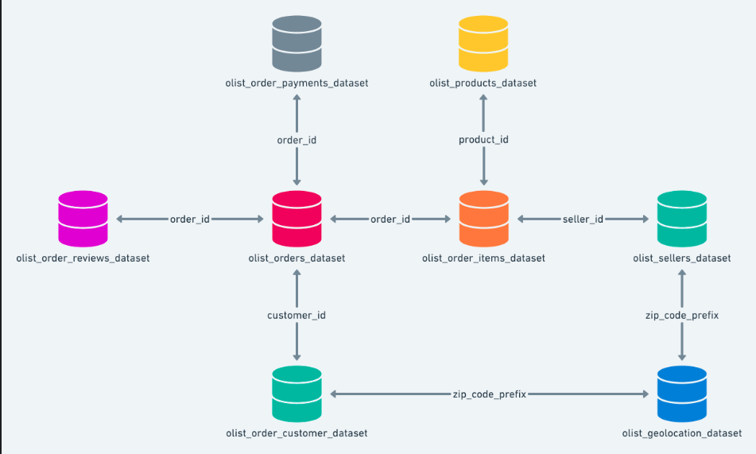

# Organização dos datasets

## **Customers Dataset**

Este conjunto de dados contém informações sobre o cliente e sua localização. Utilize-o para identificar clientes únicos no conjunto de dados de pedidos e para encontrar o local de entrega dos pedidos. Em nosso sistema, cada pedido é associado a um `customer_id` exclusivo; isso significa que o mesmo cliente receberá IDs diferentes para pedidos distintos. A finalidade de incluir um `customer_unique_id` no conjunto de dados é permitir a identificação de clientes que realizaram novas compras na loja; caso contrário, pareceria que cada pedido estava associado a um cliente diferente.

- **`Customer_id`** é a coluna de  relação com o **Orders Dataset;**
    - Mostra de quem é o pedido;
- **`customer_zip_code_prefix`** é a coluna de relação com o **Geolocation Dataset;**
    - Mostra para onde os pedidos serão enviados;

| **Coluna** | **Descrição** |
| --- | --- |
| **`customer_id`** | Chave para o conjunto de dados de pedidos. Cada pedido possui um customer_id único. |
| **`customer_unique_id`** | Identificador único de um cliente. |
| **`customer_zip_code_prefix`** | Primeiros cinco dígitos do CEP do cliente. |
| **`customer_city`** | Nome da cidade do cliente. |
| **`customer_state`** | Estado do Cliente |

## **Geolocation Dataset**

Este conjunto de dados contém informações sobre os CEPs brasileiros e suas coordenadas de latitude e longitude. Utilize-o para criar mapas e calcular distâncias entre vendedores e clientes.

- Mostra de onde os pedidos estão saindo;

| **Coluna** | **Descrição** |
| --- | --- |
| **`geolocation_zip_code_prefix`** | Primeiros cinco dígitos do CEP do cliente. |
| **`geolocation_lat`** | Latitude |
| **`geolocation_lng`** | Longitude |
| **`geolocation_city`** | Cidade |
| **`geolocation_state`** | Estado |

## **Order Items Dataset**

Este conjunto de dados inclui informações sobre os itens comprados em cada pedido.

- **`product_id`** é a coluna de relação com o **Products Dataset;**
    - Mostra qual é o produto que foi comprado;
- **`order_id`** é a coluna de relação com o **Orders Dataset;**
    - Mostra a qual pedido esse item pertence;
- **`seller_id`** é a coluna de relação com o S**ellers Dataset;**
    - Mostra de qual empresa os itens foram comprados;

**Exemplo:**
O pedido com `order_id` = 00143d0f86d6fbd9f9b38ab440ac16f5 contém 3 itens (do mesmo produto). O frete de cada item é calculado com base em suas dimensões e peso. Para obter o valor total do frete de cada pedido, basta somar os valores individuais.

- O valor total dos itens do pedido é: $21,33 * 3 = 63,99$
- O valor total do frete é: $15,10 * 3 = 45,30$
- O valor total do pedido (produto + frete) é: 45,30 + 63,99 = 109,29

| **Coluna** | **Descrição** |
| --- | --- |
| **`order_id`**  | Identificador único do pedido. |
| **`order_item_id`** | Número sequencial que identifica a quantidade de itens incluídos no mesmo pedido. |
| **`product_id`** | Identificador único do produto. |
| **`seller_id`** | Identificador único do vendedor. |
| **`shipping_limit_date`** | Mostra a data limite de envio do vendedor para que ele entregue o pedido ao parceiro logístico. |
| **`price`** | Preço do item. |
| **`freight_value`** | Valor do frete por item (se um pedido tiver mais de um item, o valor do frete será dividido entre os itens). |

## **Order Payments Dataset**

Este conjunto de dados inclui informações sobre as opções de pagamento dos pedidos.

- **`order_id`** é a coluna de relação com o **Orders Dataset;**
    - Mostra a qual pedido o pagamento está relacionado;

| **Coluna** | **Descrição** |
| --- | --- |
| **`order_id`** | Identificador único do pedido. |
| **`payment_sequential`** | Um cliente pode pagar um pedido com mais de um método de pagamento.Nesse caso, será criada uma sequência para processar todos os pagamentos. |
| **`payment_type`** | Método de pagamento escolhido pelo cliente. |
| **`payment_installments`** | Número de parcelas escolhido pelo cliente. |
| **`payment_value`** | Valor da transação. |

## **Order Reviews Dataset**

Este conjunto de dados inclui informações sobre as avaliações feitas pelos clientes.

Após um cliente comprar o produto na Olist Store, o vendedor é notificado para atender ao pedido. Assim que o cliente recebe o produto — ou quando chega a data prevista de entrega —, ele recebe uma pesquisa de satisfação por e-mail, na qual pode avaliar a experiência de compra e deixar comentários.

- **`order_id`** é a coluna de relação com o **Orders Dataset;**
    - Mostra a qual pedido essa avaliação pertence;

| **Coluna** | **Descrição** |
| --- | --- |
| **`review_id`** | Identificador único de avaliação. |
| **`order_id`** | Identificador único do pedido. |
| **`review_score`** | Nota de 1 a 5 dada pelo cliente em uma pesquisa de satisfação. |
| **`review_comment_title`** | Título do comentário deixado pelo cliente, em português. |
| **`review_comment_message`** | Mensagem de comentário da avaliação deixada pelo cliente, em português. |
| **`review_creation_date`** | Mostra a data em que a pesquisa de satisfação foi enviada ao cliente. |
| **`review_answer_timestamp`** | Exibe o registro de data e hora da resposta da pesquisa de satisfação. |

## **Orders Dataset**

Este é o conjunto de dados principal. A partir de cada pedido, você pode encontrar todas as outras informações.

- **`order_id`** é a coluna de relação com o **Order Items, Payments e  Reviews Dataset;**
- **`Customer_id`** é a coluna de  relação com o **Order Customer Dataset;**
    - Mostra de quem é o pedido;

| **Coluna** | **Descrição** |
| --- | --- |
| **`order_id`** | Identificador único do pedido. |
| **`customer_id`** | Chave para o conjunto de dados de pedidos. Cada pedido possui um customer_id único. |
| **`order_status`** | Referência ao status do pedido (entregue, enviado, etc.). |
| **`order_purchase_timestamp`** | Exibe o registro de data e hora da compra. |
| **`order_approved_at`** | Exibe o registro de data e hora da aprovação do pagamento. |
| **`order_delivered_carrier_date`** | Exibe o registro de data e hora da postagem do pedido. Indica quando ele foi entregue ao parceiro logístico. |
| **`order_delivered_customer_date`** | Mostra a data real de entrega do pedido ao cliente. |
| **`order_estimated_delivery_date`** | Exibe a data de entrega estimada que foi informada ao cliente no momento da compra. |

## **Products Dataset**

Este conjunto de dados inclui informações sobre os produtos vendidos pela Olist.

- **`product_id`** é a coluna de relação com o **Order items;**

| **Coluna** | **Descrição** |
| --- | --- |
| **`product_id`** | Identificador único do produto. |
| **`product_category_name`** | Categoria raiz do produto, em português. |
| **`product_name_lenght`** | Número de caracteres extraídos do nome do produto. |
| **`product_description_lenght`** | Número de caracteres extraídos da descrição do produto. |
| **`product_photos_qty`** | Número de fotos de produtos publicadas. |
| **`product_weight_g`**  | Peso do produto medido em gramas. |
| **`product_length_cm`** | Comprimento do produto medido em centímetros. |
| **`product_height_cm`** | Altura do produto medida em centímetros. |
| **`product_width_cm`** | Largura do produto medida em centímetros. |

## **Sellers Dataset**

Este conjunto de dados inclui informações sobre os vendedores que processaram pedidos feitos na Olist. Use-o para encontrar a localização do vendedor e identificar qual vendedor processou cada produto.

- **`seller_id`** é a coluna de relação com o **Order items;**
- **`seller_zip_code_prefix`** é a coluna de relação com o **Geolocation** **;**

| **Coluna** | **Descrição** |
| --- | --- |
| **`seller_id`** | Identificador único do vendedor. |
| **`seller_zip_code_prefix`** | Primeiros 5 dígitos do CEP do vendedor. |
| **`seller_city`** | Nome da cidade do vendedor. |
| **`seller_state`** | Estado do vendedor. |

## **Category Name Translation**

Traduz o nome da categoria do produto para inglês.

| **Coluna** | **Descrição** |
| --- | --- |
| **`product_category_name`** | Nome da categoria em português. |
| **`product_category_name_english`** | Nome da categoria em inglês. |